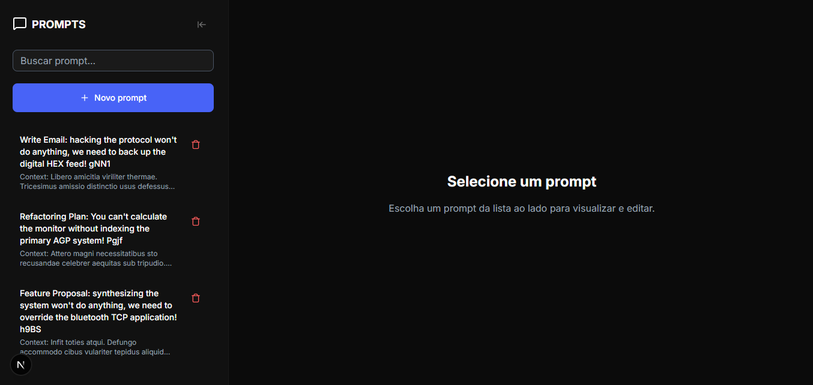
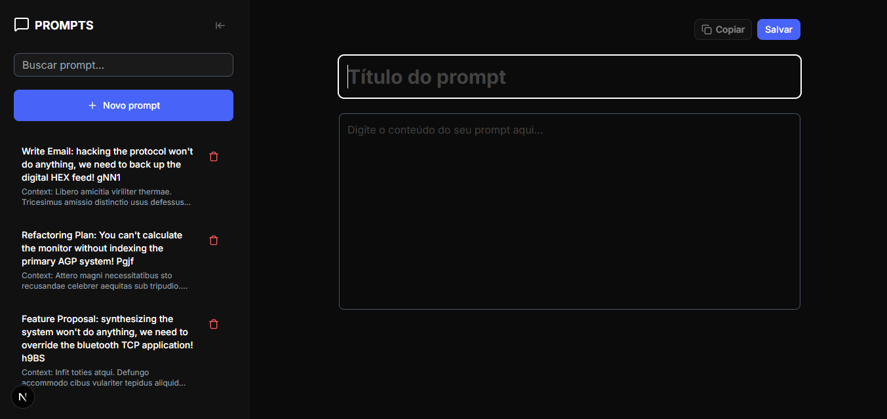
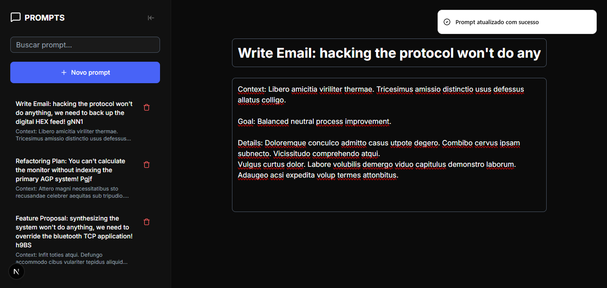
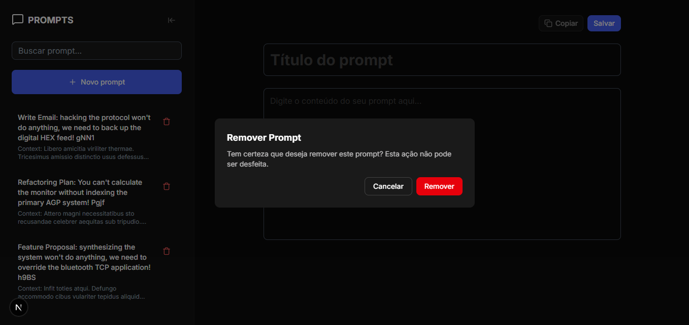

<!-- CABEÇALHO -->

    <h1>
        💬 Prompt Manager 💬
    </h1>
    

        <a href="#%EF%B8%8F-sobre-o-projeto">Sobre o Projeto</a> •
        <a href="#-funcionalidades">Funcionalidades</a> •
        <a href="#-layout">Layout</a> •
        <a href="#%EF%B8%8F-tecnologias">Tecnologias</a> •
        <a href="#-autor">Autor</a>
    

<!-- SOBRE O PROJETO -->

## 🖥️ Sobre o Projeto

    
     
     
    

 

> Projeto desenvolvido durante o curso "Testes e Arquitetura no Frontend" da [Rocketseat](https://www.rocketseat.com.br/).

O Prompt Manager é uma aplicação web que permite organizar todos os seus prompts de Inteligência Artifical em um só lugar.

Com ele você pode cadastrar, editar e buscar rapidamente os prompts que mais utiliza no dia a dia, aumentando sua produtividade e evitando perder tempo procurando informações espalhadas em anotações ou arquivos.

<!-- FUNCIONALIDADES -->

## 💡 Funcionalidades

- [x] Tela Home
  - [x] Sidebar com lista de prompts
  - [x] Pesquisar prompts
  - [x] Remover prompt
- [x] Tela de Cadastro de Prompt
  - [x] Criar novo prompt
- [x] Tela do Prompt
  - [x] Editar informações do prompt
  - [x] Copiar conteúdo do prompt

<!-- LAYOUT -->

## 🎨 Layout

  

  

  

<!-- TECNOLOGIAS -->

## 🛠️ Tecnologias

Para o desenvolvimento desse projeto, as seguintes ferramentas foram utilizadas:

- **[React.js](https://pt-br.reactjs.org/)**
- **[Next.js](https://nextjs.org/)**
- **[TypeScript](https://www.typescriptlang.org/)**
- **[Tailwind CSS](https://tailwindcss.com/)**
- **[Shadcn/UI](https://ui.shadcn.com/)**
- **[Nuqs](https://nuqs.dev/)**
- **[Prisma](https://www.prisma.io/)**
- **[React Hook Form](https://www.react-hook-form.com/)**
- **[Zod](https://zod.dev/)**
- **[Jest](https://jestjs.io/)**
- **[React Testing Library](https://testing-library.com/)**
- **[Playwright](https://playwright.dev/)**

## 👨‍💻 Autor

Marcos Kenji Kuribayashi

 

---

Desenvolvido por Marcos Kenji Kuribayashi 😉
